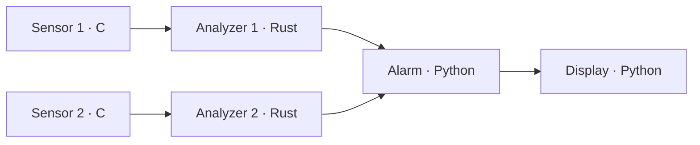

# Getting started with OSE

This guide is for anyone new to OSE. You will run an existing application,
understand its output, and change its behavior while it is running. Allow
about 15–20 minutes for the main walkthrough, excluding tool installation.
The additional workshops are optional.

OSE stands for **Orchestration, Simulation, Exécution** (orchestration,
simulation, execution). It connects programs called *components*: each receives
messages, performs a calculation, and publishes results. OSE starts these
components, coordinates their exchanges, and lets you observe them. SDL describes
the messages so that components written in different languages can communicate.

## What you will build and observe

The **Vibration Watch** demo application is included in the repository. It
monitors two simulated motors: no sensors or external hardware are required.



The sensors produce signal blocks. The analyzers calculate their **RMS**, or
root mean square, which measures vibration intensity. The alarm compares this
value against a threshold, and the display writes the result to the terminal.
All six components are real processes, including during simulation.

| Exercise | OSE capability demonstrated |
| --- | --- |
| Run Vibration Watch | Build and orchestrate C, Rust, and Python components |
| Simulate with 1 and then 4 workers | Reproduce an execution using a virtual clock |
| Observe measurements and logs | Understand an application while it runs |
| Change the alarm threshold | Apply typed parameters without restarting |
| Capture and replay signals | Test processing with recorded inputs |
| Replace a worker | Run the graph using the distributed protocol |

## 1. Prepare your terminal

This walkthrough uses **Linux or Android/Termux**, with **Bash**, Git, Make,
Python 3.10 or later, a C compiler, and Rust/Cargo. A browser is only needed
for the web workshop. Java and Ada are not required here.

Check your tools:

```sh
bash --version
git --version
make --version
python3 --version  # Or a compatible versioned command, such as python3.12
cc --version
cargo --version
rustc --version
```

If a command is missing, install the corresponding tool using your system's
package manager. For example, on Debian/Ubuntu:

```sh
sudo apt-get update
sudo apt-get install -y bash git build-essential python3 \
  python3-pip python3-dev cargo openssl
```

In Termux:

```sh
pkg install bash git make clang python rust openssl
```

Enter `bash` if your terminal uses another shell. The `source` commands below
must run in Bash. The basic demo uses the repository sources and requires no
Python package installation through pip.

### Get the project

For a first installation:

```sh
cd ~
git clone https://github.com/archambaultfrancois-ship-it/ose.git
cd ~/ose/vibration-watch
source ./setenv.sh
ose app env
```

If you already have the repository, start with `cd` and `source`. This guide
assumes it is in `~/ose`: adjust that path in **every terminal** if you cloned
it elsewhere.

`ose app env` should identify `vibration-watch` as the application and the
repository's `sdl` directory as its dependency. The script prepares paths and
the `ose` command for this terminal. It does not compile anything or change
your shell configuration. Run `source ./setenv.sh` in each new terminal.

## 2. Run your first application

From `~/ose/vibration-watch`:

```sh
make validate
make demo-local SCENARIO=increasing-vibration DURATION=3
```

Validation should print `{"valid": true}`. The second command generates SDL
bindings, compiles the C/Rust components, and runs the application for three
seconds. The first build may take a while; the requested duration applies to
execution after startup.

You will see JSON lines with fields like these:

```json
{"event":"vibration","machine_id":1,"sequence":20,"time_ns":1900000000,"rms":1.6,"peak":2.3,"state":1}
```

The numbers above are illustrative. To read your own results:

| Field | Meaning |
| --- | --- |
| `machine_id` | Motor 1 or 2 |
| `sequence` | Number of the signal block being processed |
| `time_ns` | Signal timestamp in nanoseconds |
| `rms` | Vibration intensity, in m/s² |
| `peak` | Peak value in the block |
| `state` | `0`: normal; `1`: alarm |

With `increasing-vibration`, motor 1's vibration increases and its state changes
from `0` to `1`. Motor 2 stays normal. The initial threshold is **1 m/s²** for
both motors. Build messages and observations may appear together in the terminal;
this does not indicate an error.

After the application stops, inspect its final counters:

```sh
ose inspect --last
```

This reports the last completed execution. To inspect an application that is
still running, use `ose inspect` without `--last`.

## 3. Simulate and check reproducibility

Simulation uses the same processing code and replaces real-time waiting with a
**virtual clock**. Here, `DURATION=3` means three simulated seconds, regardless
of how long your computer takes to calculate them.

Wait for the previous run to finish, then execute:

```sh
make simulate SCENARIO=increasing-vibration DURATION=3 WORKERS=1
cp build/simulation.jsonl build/quick-start-workers-1.jsonl

make simulate SCENARIO=increasing-vibration DURATION=3 WORKERS=4
cmp build/quick-start-workers-1.jsonl build/simulation.jsonl \
  && echo "OK: logical traces are identical"
```

You should see the `OK` message. A *worker* here provides capacity for concurrent
calculations: four workers allow several independent components to calculate
in parallel. The logical result stays the same; the order of lines printed to
the terminal may differ.

This comparison assumes the same sources, parameters, and environment, with
deterministic processing code such as this example. It does not promise a
fourfold speedup. Simulation does not emulate physical network delays or packet
loss. Its trace describes execution and message fingerprints; the captures in
the workshop below contain the messages themselves.

The `normal` and `increasing-vibration` profiles belong to Vibration Watch:
they configure signal generation. To inject external events at specific times,
OSE also provides a [scenario format](../ose/docs/simulation.md#external-scenarios).

## 4. Observe a running application

For the next steps, use **two Bash terminals** and keep the application running
in the first one.

**Terminal A — start with normal vibration levels:**

```sh
cd ~/ose/vibration-watch
source ./setenv.sh
app-run SCENARIO=normal
```

`app-run` builds the application and keeps it running until **Ctrl+C**.
Both motors should show `state: 0`.

**Terminal B — prepare the observation commands:**

```sh
cd ~/ose/vibration-watch
source ./setenv.sh
ose top
```

`ose top` shows components, their execution rates, and message queue status.
Use the arrow keys and Enter to explore, then `q` to leave the screen.
The application in terminal A continues running.

Still in terminal B, read three observations of the RMS measurements:

```sh
ose measure 'analyzer_*.vibration.rms' --interval 1 --count 3
```

With the `normal` profile, values are close to **0.28** for motor 1 and **0.42**
for motor 2. Measurements are the latest known values, sampled at the requested
interval.

Next, read the alarm's log entries:

```sh
ose app logs alarm --logger detection
```

Add `-f` to follow new entries; **Ctrl+C in this terminal** then stops only the
log viewer. OSE engine measurements and logs are kept in memory and disappear
when the engine stops.

## 5. Trigger an alarm without stopping the components

Terminal A is still running `app-run SCENARIO=normal`.
In terminal B, read motor 1's threshold:

```sh
ose app parameter list
ose app parameter get --exact machines/1/detection
```

The returned block should contain:

```json
{"machines/1/detection":{"rms_threshold":1.0}}
```

Lower this threshold to 0.1 m/s²:

```sh
printf '%s\n' '{"machines/1/detection":{"rms_threshold":0.1}}' \
  | ose app parameter set --file -
ose app parameter get --exact machines/1/detection
```

In terminal A, **motor 1 enters the alarm state** (`state: 1`) because its RMS
remains above 0.1. Motor 2 stays normal. No component has been rebuilt or
restarted. You have changed a shared parameter whose type is checked against
the SDL contract.

Restore the original threshold:

```sh
printf '%s\n' '{"machines/1/detection":{"rms_threshold":1.0}}' \
  | ose app parameter set --file -
```

Motor 1 returns to `state: 0`. The change becomes visible as subsequent messages
are processed. A write replaces the complete block; for a block with several
required fields, supply all of them. In this example, the threshold changed in
memory returns to its initial configuration on the next build/run; it does not
rewrite `config/thresholds.json`.

You can stop terminal A with **Ctrl+C**. OSE stops the components and calls
their shutdown functions, named `on_stop`.

## Optional workshop: explore the web console

Start `app-run SCENARIO=normal` again in terminal A. In terminal B, from the
same directory and after `source ./setenv.sh`:

```sh
ose-ws setup
ose-ws
```

`setup` installs optional dependencies into the framework's `build/python-deps`
and needs network access the first time. All commands use the same detected Python 3.10+ from `PATH`, including
versioned commands such as `python3.12`. `make setup` at the repository root prepares all Python dependencies.
The frontend is included: no Node.js build is needed.

Open **http://127.0.0.1:8080**. In a third terminal, read the local token and
copy it into the sign-in page:

```sh
cat ~/ose/vibration-watch/.ose-ws/access.token
```

This token is a local secret; keep the console on its loopback address.
Try this tour of the interface:

1. **Components → Application flow**: find the graph of all six components.
2. Select the **events** link, then **Diagnose compatibility**: the alarm contract
   remains compatible with the observer's contract despite the extra
   `source_note` field. **Live** shows a recent publication.
3. **Measurements**: select both analyzers' `vibration.rms` measurements to
   follow their evolution.
4. **Logs**: filter by component `alarm` and category `detection`.
5. **Parameters**: open `machines/1/detection`, change `rms_threshold`, validate,
   and apply the block. Observe the alarm, then restore `1.0`.

**Ctrl+C** stops the web server in its terminal; the application keeps running.

## Optional workshop: record and replay signals

Prepare the optional services **before** starting the application you will
record. Stop terminal A with Ctrl+C first. In terminal B:

```sh
ose app record deps
```

This preparation uses pip and the Python development headers to download
dependencies and build the native filter when needed. Subsequent runs reuse
them. In terminal A, restart:

```sh
app-run SCENARIO=normal
```

In terminal B, start a two-second capture:

```sh
ose app record \
  --command 'select sensor_*.signal' \
  --command 'start build/quick-start-signals.pcapng' \
  --command 'wait 2' \
  --command stop \
  --command quit

ose app record inspect build/quick-start-signals.pcapng --check --summary
```

The capture should contain both topics, `sensor_1.signal` and `sensor_2.signal`,
with nonzero counters and no validation errors. The file is created in the
application's `build` directory. To repeat this workshop, choose a new capture
filename to keep the first file.

Now stop terminal A, then replay the capture in terminal B:

```sh
make replay RECORDING=build/quick-start-signals.pcapng DURATION=3 WORKERS=4
```

Vibration Watch builds a replay graph that replaces the sensors with external
inputs. The analyzers and alarm process the recorded signals. Both motors
should stay normal, as they did during capture. The trace is in
`build/replay/trace.jsonl`. Original signal timestamps remain in the messages;
replay controls their order and intervals.

OSE can also capture an internal point such as `analyzer_1.record.dsp.input`,
filter messages at their source, and replay in real time with pause and speed
controls. See [recording](../ose/docs/recording.md) and
[replay](../ose/docs/replay.md).

## Optional workshop: distribute execution and replace a worker

Stop any local execution and the web console before this workshop.
From `~/ose/vibration-watch`:

```sh
make demo-distributed SCENARIO=normal DURATION=8 FAIL_NODE=analyzer_1
```

The demo starts a coordinator and six workers using the distributed protocol
on your computer. Halfway through, its script stops and restarts the
`analyzer_1` worker. The other workers stay in place; the replacement worker
starts with empty state.

Inspect process identifiers before and after replacement:

```sh
python3 -m json.tool build/distributed-processes.json
```

The PID of `analyzer_1` should change while the other workers' PIDs stay the
same. Logs are in `build/distributed-logs/`. This is a local replacement demo,
not a physical machine failure test. Deployment across multiple machines uses
the network settings and TLS authentication described in the
[distributed execution guide](../ose/docs/distributed.md).

## Understand the files to create your own application

| Vibration Watch file | Purpose |
| --- | --- |
| `schemas/*.sdl` | Structure of exchanged messages and parameters |
| `model.json` | Components, connections, triggers, and message queues |
| `deployment.local.json` | Language and implementation of each local component |
| `components/` | Application logic: acquisition, calculation, alarm, and display |
| `config/` and `scenarios/` | Initial values and signal profiles |
| `build/plan.json` | Generated plan using your machine's paths and tools |

Edit the sources and rebuild with `app-build`. The plan is generated: rebuild
it after moving the repository or changing the framework. For your first
Python component, continue with the [callback guide](../ose/docs/callbacks.md).
The [shared_parameters example](../ose/examples/shared_parameters/README.md)
also provides a smaller exercise that requires neither C nor Rust compilation.

## Troubleshooting

| Symptom | Action |
| --- | --- |
| `ose: command not found` | Open Bash, enter `vibration-watch`, and run `source ./setenv.sh`. |
| `source: not found` | Run `bash`, then repeat the terminal preparation. |
| C compiler or Cargo missing | Install the build tools and check `cc --version`, `cargo --version`, and `rustc --version`. |
| A command looks for the wrong plan | Check `pwd` and `ose app env`; return to `~/ose/vibration-watch`. |
| Connection refused or measurements unavailable | Wait for the build and startup in terminal A to finish, then retry observation. A completed simulation has no active server. |
| The demo stops after three seconds | This is the default duration of `make demo-local`; use `app-run` to continue until Ctrl+C. |
| The alarm stays active after restoring the threshold | Check that you started with `SCENARIO=normal`; the increasing profile keeps raising vibration levels. |
| Web dependencies missing | Run `ose-ws setup`, then `ose-ws`, from the application's environment. |
| Web port 8080 is occupied | Use `ose-ws --port 8081`, then open that address. |
| Termux suspends processes | Keep the device awake; if available, use `termux-wake-lock`, then `termux-wake-unlock` after the demo. |

OSE keeps message queues in RAM; stopping does not restore them. An
acknowledgement confirms admission into memory, not completion of application
processing. Use explicit captures to preserve signals.

## Next steps

- [Vibration Watch: detailed examples and parameters](../vibration-watch/README.md).
- [Application environment and commands](application-environment.md): shell setup, recording options, and parameter import/export.
- [All OSE capabilities](../ose/docs/features.md), including Java, Ada, and external clients.
- [Delivery policies](../ose/docs/delivery.md): FIFO or latest value, capacities, overflow, and retries.
- [Simulation](../ose/docs/simulation.md), [parameters](../ose/docs/parameters.md), and the [web console](../ose-ws/README.md).
- [Installation outside the repository](release.md): a standalone bundle with private Python; applications remain separate and must be rebuilt.

This walkthrough uses the repository because it includes the example application.
The installation bundle distributes the framework and does not include Vibration Watch.
