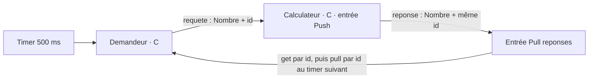

# Tutoriel : créer une application OSE en C, de zéro aux exécutions locales

Nous allons construire une petite calculatrice : elle reçoit un nombre et renvoie
son double. Toute la logique applicative sera écrite en C. SDL décrit les messages,
et deux fichiers JSON décrivent le graphe et son déploiement. OSE génère les codecs,
les conteneurs et leur `main`, compile les composants et organise leur exécution.

Ce guide suppose que vous savez lire une fonction C et un objet JSON. Il ne
nécessite ni matériel ni serveur distant. Le parcours de base se fait entièrement
dans le terminal ; les derniers ateliers proposent aussi une console web et un
éditeur graphique accessibles dans votre navigateur.

Prévoyez **environ 1 h à 1 h 30 pour le tutoriel complet**, hors installation
des outils et téléchargement ou compilation des dépendances :

- **30 à 45 minutes** pour créer, compiler et exécuter l'application C
  (sections 1 à 11) ;
- **15 à 20 minutes** pour enregistrer et inspecter les messages (section 12) ;
- **10 à 15 minutes** pour explorer la console web (section 13) ;
- **10 à 15 minutes** pour modifier le modèle avec l'éditeur (section 14).

Une [version prête à exécuter](../ose/examples/calculatrice-c/README.md)
est aussi fournie dans le dépôt ; ici, nous recréons ses cinq fichiers depuis
un dossier vide.

## 1. Spécification avant de coder

L'application doit respecter les règles suivantes :

1. Le **demandeur** possède un timer périodique de 500 ms. À sa première
   activation, il envoie la valeur **1** avec l'identifiant applicatif **1**.
2. Le **calculateur** reçoit la requête sur une entrée **Push**. Son handler
   multiplie la valeur par deux et publie la réponse avec le même identifiant.
3. La réponse arrive dans l'entrée **Pull** du demandeur : sa réception
   n'appelle aucun handler.
4. À une activation ultérieure du timer, le demandeur cherche la réponse par
   identifiant avec **get**. Si elle n'est pas encore disponible, il attend
   l'activation suivante, sans bloquer le processus.
5. Quand elle est disponible, il vérifie le résultat, puis la retire avec
   **pull**, en utilisant le même identifiant. Un second get vérifie l'absence.
6. Il passe alors à **2**, puis **3**, selon la même procédure. Il n'y a jamais
   plus d'une requête en attente.
7. Après réception des trois résultats **2, 4, 6**, le demandeur désarme son
   timer et affiche une confirmation.

Les valeurs restent volontairement limitées à 1, 2 et 3 : nous n'avons besoin
ni d'un parseur de commandes ni d'une gestion du débordement arithmétique.
Les files résident en mémoire ; cet exercice ne prévoit pas de reprise après
arrêt d'un composant.



| Notion | Ce qui déclenche le traitement | Opération dans notre application |
| --- | --- | --- |
| Timer | Échéance de l'horloge | `on_horloge` envoie ou consulte une réponse |
| Push | Réception d'un message | `on_requete` calcule le double |
| Pull | Rien à la réception ; lecture explicite depuis un autre handler | `pull_reponses` lit et retire une réponse |
| Get par id | Appel explicite depuis un handler | `get_reponses` consulte sans retirer |

**Get n'est pas un troisième mode d'entrée.** C'est une opération de lecture
sur une entrée Pull. Push/Pull déterminent l'activation ; FIFO/latest déterminent
la conservation des messages. Nous utilisons ici deux files FIFO.

## 2. Préparer les outils et le dossier vide

Le parcours utilise Linux ou Android/Termux et un terminal **Bash**. Les commandes
sont données pour un dépôt cloné dans `~/ose` et une nouvelle application dans
`~/calculatrice-ose`. Adaptez ces deux chemins si nécessaire.

Vérifiez les outils :

```sh
bash --version
git --version
python3 --version
cc --version
```

Il faut Python **3.10 ou plus récent** et un compilateur C99. Ce parcours
utilise directement les sources du framework et ne nécessite aucun paquet pip
supplémentaire. L'environnement sait aussi sélectionner un Python versionné
compatible, tel que `python3.12`.

Exemple d'installation sous Debian/Ubuntu :

```sh
sudo apt-get update
sudo apt-get install -y bash git build-essential python3
```

Sous Termux :

```sh
pkg install bash git clang python
```

Passez dans Bash si votre terminal utilise un autre shell :

```sh
bash
```

Récupérez le framework si vous ne l'avez pas encore :

```sh
cd ~
git clone https://github.com/archambaultfrancois-ship-it/ose.git
```

Créez l'application **en dehors** du framework, puis chargez son environnement :

```sh
mkdir -p ~/calculatrice-ose
cd ~/calculatrice-ose
unset OSE_APP_ROOT
source ~/ose/setenv.sh
ose app env
```

`unset OSE_APP_ROOT` évite de conserver la sélection d'une autre application.
La sortie doit désigner `~/calculatrice-ose` comme application et `~/ose/sdl`
comme racine SDL. `source` prépare les chemins et la commande `ose` dans ce
terminal ; il ne compile rien et n'installe rien. Reprenez ces commandes dans
chaque nouveau terminal.

Nous utiliserons les commandes explicites `ose validate`, `ose build` et
`ose run`. Elles suffisent : aucun Makefile applicatif n'est nécessaire.

## 3. Définir le message SDL

Créez `messages.sdl` dans `~/calculatrice-ose` avec ce contenu :

```sdl
message Nombre {
    1: required uint32 valeur;
}
```

Le type `Nombre` contient un entier non signé sur 32 bits. Le champ est
obligatoire ; `1:` est son numéro dans le contrat SDL.

L'identifiant de requête n'est pas un champ de ce message. C'est une
**métadonnée OSE**, posée par `publish_requete_with_id` et consultée via
`input->meta.app_id`. Un identifiant absent est différent de l'identifiant zéro ;
`has_app_id` indique sa présence. Ici nous choisissons simplement 1, 2 et 3.

## 4. Décrire les composants et leurs connexions

Créez `model.json` :

```json
{
  "version": 2,
  "schemas": "messages.sdl",
  "components": {
    "demandeur": {
      "inputs": {
        "horloge": {
          "kind": "timer",
          "timer": {"mode": "periodic", "delay": 0.5},
          "activates": {"timeout": ["requete"]}
        },
        "reponses": {"root": "Nombre", "mode": "pull"}
      },
      "outputs": {"requete": {"root": "Nombre"}}
    },
    "calculateur": {
      "inputs": {
        "requete": {
          "root": "Nombre",
          "mode": "push",
          "activates": {"message": ["reponse"]}
        }
      },
      "outputs": {"reponse": {"root": "Nombre"}}
    }
  },
  "subscriptions": [
    {
      "id": "aller",
      "from": "demandeur.requete",
      "to": "calculateur.requete",
      "qos": {"buffer": "fifo", "capacity": 4}
    },
    {
      "id": "retour",
      "from": "calculateur.reponse",
      "to": "demandeur.reponses",
      "qos": {"buffer": "fifo", "capacity": 4}
    }
  ]
}
```

Le modèle applicatif est en **version 2**. Les chemins des schémas sont relatifs
au fichier modèle. Chaque composant déclare ses entrées et ses sorties.

Dans `demandeur`, `horloge` est un timer périodique. Son démarrage automatique
est la valeur par défaut ; sa première échéance survient après 0,5 seconde.
`reponses` est une entrée Pull passive : elle n'a ni timer, ni callback propre.
Dans `calculateur`, l'entrée `requete` est Push : elle déclenche `on_requete`.

**`activates` autorise des publications.** L'événement `timeout` du timer
peut publier sur `requete` ; l'événement `message` du calculateur peut publier
sur `reponse`. Ces autorisations ne déclenchent pas de publication automatique.
Sans elles, les appels de publication correspondants échoueraient.

Les deux `subscriptions` relient les sorties aux entrées. Leur `id` (`aller`,
`retour`) nomme une connexion ; il est indépendant de l'identifiant applicatif
numérique de chaque message. `capacity: 4` réserve quatre places par file ;
la politique de débordement par défaut est `reject_new`. Notre protocole avec
une seule requête en attente évite de les remplir pendant une exécution normale.
Le transport local TCP est utilisé par défaut en temps réel.

## 5. Choisir les implémentations C

Créez `deployment.json` :

```json
{
  "version": 1,
  "components": {
    "demandeur": {
      "container": {"language": "c", "handler": "demandeur.c"}
    },
    "calculateur": {
      "container": {"language": "c", "handler": "calculateur.c"}
    }
  }
}
```

Le déploiement reste en **version 1**, même avec un modèle en version 2.
Il associe chaque composant à un langage et à un fichier de handlers. Ces chemins
sont relatifs au fichier de déploiement. Aucun conteneur Docker n'est nécessaire :
le « conteneur » OSE est ici le programme généré qui entoure vos callbacks.

Validez maintenant la description, avant d'écrire les handlers :

```sh
ose validate --model model.json --deployment deployment.json
```

La sortie doit contenir `{"valid": true}`. La validation vérifie notamment
les types SDL, les connexions et les autorisations. Les handlers peuvent encore
être absents à ce stade ; la validation ne compile pas leur code C.

## 6. Écrire le calculateur : un handler Push

Créez `calculateur.c` :

```c
#include "component.h"
#include <inttypes.h>
#include <stdio.h>

static int on_requete(OseContext *ctx, const Input_requete *input) {
    Nombre reponse = {0};
    if (!input->message || !input->meta.has_app_id)
        return ose_fail(ctx, "requete sans message ou sans identifiant");

    reponse.valeur = 2 * input->message->valeur;
    printf("[push] id=%" PRIu64 " : %" PRIu32 " -> %" PRIu32 "\n",
            input->meta.app_id, input->message->valeur, reponse.valeur);
    return publish_reponse_with_id(ctx, &reponse, input->meta.app_id);
}

const ComponentCallbacks component_callbacks = {.on_requete = on_requete};
```

`component.h` sera généré au build. Il déclare `Nombre`, `Input_requete`, les
fonctions de publication et `ComponentCallbacks`. Vous n'avez pas de `main`
à écrire et n'avez pas à encoder vous-même les messages SDL.

À chaque requête, `input->message` donne accès à la structure C décodée.
Le handler vérifie la présence du message et de son identifiant, calcule
`2 * valeur`, puis publie la réponse en conservant l'identifiant.
La dernière ligne enregistre la fonction dans la table des callbacks.

Les callbacks renvoient **1 en cas de succès, 0 en cas d'échec**.
`ose_fail` décrit une erreur et renvoie zéro. Les publications sont mises en
attente et ne sont validées qu'à la réussite du callback.

Pour rendre les étapes immédiatement visibles, cet exercice utilise `printf`.
Les flux standards appartiennent au composant : OSE échange ses trames CH/2 sur
une socket Unix privée, créée automatiquement par le moteur. Les bibliothèques
peuvent donc également écrire sur stdout et stderr. Pour des journaux consultables
avec les outils OSE, utilisez `ose_logf` ; les lignes ci-dessus sont de simples
affichages du terminal.

## 7. Écrire le demandeur : timer, get par id et pull

Créez `demandeur.c` :

```c
#include "component.h"
#include <inttypes.h>
#include <stdio.h>

/* Chaque composant tourne dans son propre processus. */
static uint64_t prochain = 1;
static uint64_t attente = 0;

static int on_horloge(OseContext *ctx, const Input_horloge *input) {
    (void)input; /* Un timer ne transporte pas de message SDL. */

    if (attente != 0) {
        OseSelector choix = {.has_app_id = 1, .app_id = attente};
        Input_reponses lecture, retrait, verification;

        if (!get_reponses(ctx, &choix, &lecture)) return 0;
        if (!lecture.message) return 1; /* Reessayer au prochain timer. */
        if (lecture.message->valeur != 2 * attente)
            return ose_fail(ctx, "resultat incorrect");
        printf("[get] id=%" PRIu64 " : valeur=%" PRIu32 "\n",
                attente, lecture.message->valeur);

        /* get a conserve la reponse : pull peut encore la lire et la retirer. */
        if (!pull_reponses(ctx, &choix, &retrait)) return 0;
        if (!retrait.message) return ose_fail(ctx, "reponse introuvable au pull");
        if (!get_reponses(ctx, &choix, &verification)) return 0;
        if (verification.message) return ose_fail(ctx, "reponse encore presente");
        printf("[pull] id=%" PRIu64 " : retiree, get suivant vide\n", attente);
        attente = 0;
    }

    if (prochain > 3) {
        printf("[fin] 3 resultats verifies : 2, 4, 6\n");
        return ose_disarm(ctx, "horloge");
    }

    Nombre requete = {0};
    requete.valeur = (uint32_t)prochain;
    if (!publish_requete_with_id(ctx, &requete, prochain)) return 0;
    printf("[timer] envoi id=%" PRIu64 " : valeur=%" PRIu32 "\n",
            prochain, requete.valeur);
    attente = prochain;
    prochain++;
    return 1;
}

const ComponentCallbacks component_callbacks = {.on_horloge = on_horloge};
```

Deux entiers constituent tout l'état du demandeur : `prochain` est la valeur
à envoyer et `attente` l'identifiant recherché, ou zéro si aucune réponse
n'est attendue. Chaque composant a son propre processus ; ces variables
statiques appartiennent seulement au demandeur. Elles sont réinitialisées à
chaque nouvelle exécution. Pour un état plus élaboré, l'API fournit également
`ctx->user_data`.

Suivez une activation de `on_horloge` :

1. S'il existe une réponse attendue, `OseSelector` filtre l'entrée Pull sur
   son identifiant applicatif. Les autres critères restent nuls.
2. `get_reponses` renvoie zéro en cas d'erreur. Un retour de **1 avec
   `lecture.message == NULL` signifie simplement « aucune réponse disponible »**.
   Le callback termine alors avec succès et réessaiera à l'échéance suivante.
3. Si la réponse est présente, le code vérifie le double attendu. `get` a
   laissé le message dans la file : `pull_reponses` peut donc encore le lire
   et le retirer en utilisant le même sélecteur.
4. Un nouveau `get` confirme qu'il n'est plus visible. Le retrait libère
   effectivement la place à la réussite du callback ; en cas d'échec, le
   retrait en attente est annulé.
5. Le demandeur envoie le nombre suivant ou appelle `ose_disarm` quand les
   trois résultats ont été vérifiés.

Ces lectures ne bloquent pas en attendant un message. Un callback voit les
messages encore présents qui étaient accessibles au début de son activation ;
une arrivée ultérieure sera consultable à une activation suivante. Ce mécanisme
et l'attente d'une réponse avant l'envoi suivant évitent de supposer un délai
réseau précis.

Un sélecteur `NULL` choisirait le plus ancien message admissible. Ici,
`has_app_id = 1` et `app_id = attente` sélectionnent le plus ancien message
portant **cet identifiant**. L'identifiant n'est pas une contrainte d'unicité
imposée par OSE : notre application en publie un seul par requête.

Les pointeurs des références lues sont empruntés au runtime et ne sont valides
que pendant le callback. Nous ne les conservons pas dans les variables statiques.

## 8. Générer et compiler l'application complète

Votre dossier doit maintenant contenir :

```text
calculatrice-ose/
  messages.sdl
  model.json
  deployment.json
  calculateur.c
  demandeur.c
```

Toujours depuis ce dossier et dans le terminal préparé :

```sh
ose build --model model.json --deployment deployment.json
```

Cette commande valide les descriptions, génère les types et codecs C depuis SDL,
génère les conteneurs OSE, compile les deux exécutables C et écrit
`build/plan.json`. Le compilateur utilise C99 avec `-Wall -Wextra -Werror`.
Le plan contient les chemins nécessaires à l'exécution sur votre machine.

N'éditez pas le code généré dans `build/`. Modifiez vos cinq fichiers sources,
puis relancez le build. OSE préserve les handlers existants ; si un handler est
absent, le builder peut en créer un squelette. Ici nous avons déjà fourni les
deux implémentations complètes.

## 9. Première exécution locale : simulation

```sh
ose run --plan build/plan.json --mode simulated --duration 5 --workers 1 \
  --trace build/trace-1.jsonl
```

Les composants sont de vrais programmes C locaux. Le simulateur les pilote avec
une horloge virtuelle : les cinq secondes sont un horizon de temps simulé,
pas cinq secondes d'attente imposées à votre terminal.

L'ordre des affichages entre processus peut varier, notamment si stdout est
redirigé vers un fichier et utilise alors un tampon.

Vous devez voir cette progression sur stdout, ainsi qu'un bilan JSON du moteur :

```text
[timer] envoi id=1 : valeur=1
[push] id=1 : 1 -> 2
[get] id=1 : valeur=2
[pull] id=1 : retiree, get suivant vide
[timer] envoi id=2 : valeur=2
[push] id=2 : 2 -> 4
[get] id=2 : valeur=4
[pull] id=2 : retiree, get suivant vide
[timer] envoi id=3 : valeur=3
[push] id=3 : 3 -> 6
[get] id=3 : valeur=6
[pull] id=3 : retiree, get suivant vide
[fin] 3 resultats verifies : 2, 4, 6
```

Dans cette simulation, les requêtes partent à 0,5, 1 et 1,5 seconde ; les réponses
sont consultées à 1, 1,5 et 2 secondes. Après le désarmement, le moteur n'a plus
rien à activer : son bilan indique `"stop_reason": "quiescent"`. Le simulateur peut donc
s'arrêter avant l'horizon de cinq secondes.

`build/trace-1.jsonl` contient la trace logique du moteur, distincte des
lignes affichées par les handlers. Vous pouvez la consulter avec :

```sh
cat build/trace-1.jsonl
```

## 10. Deuxième exécution locale : temps réel

Le même plan et les mêmes handlers s'exécutent maintenant avec l'horloge réelle :

```sh
ose run --plan build/plan.json --mode realtime --duration 5
```

OSE lance les deux composants et le broker local, puis transporte les messages
sur votre machine. Aucun service à démarrer dans un autre terminal.
Vous devez retrouver les résultats **2, 4, 6** et la ligne `[fin]`.
Selon la charge de la machine, une réponse peut nécessiter une échéance de plus
avant sa lecture. Le code conserve alors l'identifiant attendu et réessaie.

**Désarmer le timer arrête les demandes, pas le moteur temps réel.** Celui-ci
reste actif jusqu'aux cinq secondes demandées. Si la machine est fortement
ralentie et que `[fin]` n'apparaît pas, relancez avec `--duration 15`.

Pour une exécution sans durée imposée :

```sh
ose run --plan build/plan.json --mode realtime
```

Les calculs finissent puis les processus restent disponibles. Arrêtez le moteur
avec **Ctrl+C** dans ce terminal. Relancer `ose run` repart de 1.

## 11. Vérifier le comportement et faire varier le modèle

### Comparer deux simulations

```sh
ose run --plan build/plan.json --mode simulated --duration 5 --workers 4 \
  --trace build/trace-4.jsonl
cmp build/trace-1.jsonl build/trace-4.jsonl && echo 'OK : traces identiques'
```

Le code et les paramètres étant identiques et déterministes, les traces
logiques doivent coïncider. Cette application ne cherche pas à mesurer une
accélération avec quatre workers : elle attend volontairement chaque réponse.

### Ralentir le timer

Dans `model.json`, passez `delay` de `0.5` à `1.0`, puis :

```sh
ose build --model model.json --deployment deployment.json
ose run --plan build/plan.json --mode realtime --duration 6
```

Le premier envoi arrive après une seconde, puis chaque réponse est consultée
à une échéance suivante. Les résultats restent 2, 4 et 6. Restaurez `0.5` et
reconstruisez avant de refaire les comparaisons du parcours initial.

### Observer le rôle de get

Remplacez temporairement `pull_reponses` par `get_reponses` dans le handler
du demandeur et reconstruisez. La vérification suivante trouve encore le message
et déclenche `reponse encore presente` : deux get ne consomment pas la réponse.
Restaurez `pull_reponses`, puis reconstruisez pour retrouver l'application normale.
Un échec de callback interrompt le parcours normal ; les affichages stdout déjà
émis ne sont pas annulés.

## 12. Enregistrer les messages avec ose record

### Préparer une application qui reste active

Les trois échanges du parcours initial finissent en environ deux secondes.
Pour avoir le temps de manipuler les outils, remplacez temporairement le bloc
`if (prochain > 3)` de `demandeur.c` par :

```c
    if (prochain > 3) {
        printf("[fin] 3 resultats verifies : 2, 4, 6 ; nouveau cycle\n");
        prochain = 1;
    }
```

Le timer reste armé : les séquences 1, 2, 3 se répètent jusqu'à l'arrêt du moteur.
Chaque réponse est toujours retirée avant la requête suivante. Cette variante
servira aussi pour la console web de la section suivante.

Ces ateliers ajoutent des dépendances au parcours C de base. Depuis un terminal
préparé avec `source ~/ose/setenv.sh`, préparez les services d'enregistrement et
la console web **avant de démarrer le moteur** :

```sh
make -C ~/ose setup
ose build --model model.json --deployment deployment.json
```

`make setup` installe les dépendances Python dans le framework et compile les
services SDL. Il nécessite pip, Cargo/Rust, un compilateur C et les en-têtes de
développement Python ; un accès réseau est nécessaire à la première préparation.
Le frontend web est fourni, sans compilation Node.js. Pour préparer uniquement
l'enregistrement, utilisez `ose app record deps` à la place de `make setup`.

Dans le **terminal A**, lancez l'application sans limite de durée :

```sh
ose run --plan build/plan.json --mode realtime
```

### Choisir les points et capturer en mode interactif

Dans un **terminal B**, ouvrez le même dossier et rechargez l'environnement :

```sh
cd ~/calculatrice-ose
source ~/ose/setenv.sh
ose record --endpoint build/endpoint.json
```

Le recorder se connecte au broker du moteur déjà lancé. Dans sa console,
saisissez ces commandes une par une :

```text
list --kind output
show --kind output demandeur.requete
select --kind output demandeur.requete calculateur.reponse
selected
start build/calculatrice.pcapng
wait 5
status
stop
quit
```

`list` découvre les points disponibles ; `show` affiche le contrat SDL.
Nous sélectionnons explicitement les **sorties** pour enregistrer les requêtes
et les réponses publiées. `status` affiche notamment les compteurs de capture.
`stop` termine le fichier proprement ; `quit` ferme le recorder et laisse
l'application tourner. La capture commence à `start` : elle ne récupère pas
les messages émis auparavant, ni les lignes `printf` du terminal.

### Automatiser une capture et filtrer les réponses

Toujours dans le terminal B, cette commande produit un fichier MCAP contenant
seulement les réponses dont `valeur` vaut au moins 4 :

```sh
ose record --endpoint build/endpoint.json \
  --command 'select --kind output calculateur.reponse' \
  --command 'filter --kind output calculateur.reponse valeur >= 4' \
  --command 'start build/reponses.mcap mcap' \
  --command 'wait 5' \
  --command status \
  --command stop \
  --command quit
```

Les `--command` sont exécutés dans l'ordre. Le second argument `mcap` de
`start` choisit explicitement le format ; le filtre s'applique aux champs SDL
des messages. Vous devez donc retrouver des valeurs **4 et 6** dans ce fichier.
Choisissez un nouveau nom de fichier pour conserver chaque capture.

Consultez ensuite les fichiers, même après l'arrêt de l'application :

```sh
ose app record info build/calculatrice.pcapng
ose app record inspect build/calculatrice.pcapng --check --summary
ose app record inspect build/reponses.mcap --limit 10 --format table
```

`--check` valide le contenu SDL et produit un bilan ; `--summary` compte les
messages par topic. Sans ces options de bilan, `--limit 10` affiche au plus
dix messages, ici avec leurs champs SDL sous forme de tableau.
Les sous-commandes de lecture des fichiers passent ici par `ose app record`.

## 13. Lancer la console web

Gardez l'application en temps réel dans le terminal A. Dans le terminal B,
depuis `~/calculatrice-ose` et après la préparation `make setup` ci-dessus :

```sh
source ~/ose/setenv.sh
ose-ws init --config ose-ws.json
ose-ws check --config ose-ws.json
ose-ws --config ose-ws.json
```

`setenv.sh` fournit directement la commande `ose-ws` et les chemins nécessaires.
`init` crée la configuration et le jeton local : ne le relancez pas si ces
fichiers existent déjà. Aux lancements suivants, seule la dernière commande
est nécessaire après la préparation de l'environnement. `check` vérifie la
configuration sans se connecter au moteur. Le serveur utilise par défaut
`build/endpoint.json` pour retrouver l'application.

Ouvrez **http://127.0.0.1:8080**. Dans un **terminal C**, lisez le jeton :

```sh
cat ~/calculatrice-ose/.ose-ws/access.token
```

Copiez-le dans la page de connexion et gardez-le privé. Dans **Components →
Application flow**, retrouvez les deux composants et les connexions `aller`
et `retour`. Sélectionnez un lien pour consulter les contrats et observer les
publications avec **Live**. La page **Recordings** permet aussi de sélectionner
des points, démarrer une capture, l'arrêter et télécharger le fichier.

Les `printf` du tutoriel restent dans le terminal A. Pour alimenter la page
**Logs**, les handlers doivent émettre des journaux structurés avec `ose_logf`.
Cette application ne déclare pas de mesures ni de paramètres partagés.

**Ctrl+C** dans le terminal B arrête le serveur web ; l'application continue.
Si le port est occupé, utilisez `ose-ws --config ose-ws.json --port 8081` et
ouvrez **http://127.0.0.1:8081**. La console observe une application existante ;
elle ne lance pas le moteur.

À la fin des ateliers, arrêtez le moteur avec **Ctrl+C** dans le terminal A,
restaurez le bloc d'origine avec `ose_disarm`, puis relancez `ose build` pour
retrouver le parcours à trois résultats.

## 14. Modifier le modèle avec ose-editor

Vous pouvez aussi modifier les fichiers de l'application avec l'éditeur
graphique. Arrêtez le moteur avant cet exercice. Depuis un terminal Bash :

```sh
cd ~/calculatrice-ose
source ~/ose/setenv.sh
ose-editor --model model.json --deployment deployment.json
```

La préparation `make setup` de la section 12 inclut déjà l'éditeur. Si vous
avez suivi seulement le parcours C, le premier lancement prépare automatiquement
les dépendances manquantes ; vous pouvez aussi le faire explicitement avec
`ose-editor setup`. Cette préparation nécessite les outils et l'accès réseau
décrits en section 12. Le frontend est fourni.

Ouvrez **http://127.0.0.1:8082** et saisissez le jeton affiché par cette commande
dans un autre terminal :

```sh
cat ~/calculatrice-ose/.ose-editor/access.token
```

L'éditeur travaille sur `model.json`, `deployment.json` et `messages.sdl`.
Il fonctionne sans moteur en cours d'exécution. La console `ose-ws` de la section
précédente sert, elle, à observer l'application lancée.

### Ralentir le timer depuis le graphe

Reprenez graphiquement la modification de la section 11 :

1. Dans **Graph**, retrouvez `demandeur`, `calculateur` et leurs connexions.
   Double-cliquez sur `demandeur` pour ouvrir l'édition de ce composant.
2. Sélectionnez l'entrée timer `horloge`. Dans **Input execution**, remplacez
   **Delay (seconds)** par `1.0`. Gardez le mode `periodic`, le démarrage
   `automatic` et la sortie `requete` autorisée pour l'événement **Timeout**.
3. Cliquez sur **Preview input changes**, examinez le diff JSON, puis sur
   **Apply changes**. L'opération modifie le brouillon de l'éditeur.
4. Cliquez sur **Validate** pour vérifier ce brouillon avec le déploiement C,
   puis sur **Save** pour écrire les fichiers de l'application.

Vous pouvez également examiner `calculateur.requete` en mode Push et
`demandeur.reponses` en mode Pull, ou activer **Activation links** pour visualiser
les autorisations de publication. Les handlers C restent à modifier manuellement
si vous changez des noms de ports ou leurs modes.

Dans un autre terminal préparé, reconstruisez et exécutez le modèle enregistré :

```sh
ose validate --model model.json --deployment deployment.json
ose build --model model.json --deployment deployment.json
ose run --plan build/plan.json --mode realtime --duration 6
```

Le timer se déclenche maintenant toutes les secondes. **Validate** dans
l'éditeur ne compile pas les handlers : `ose build` reste nécessaire pour
actualiser le plan et les conteneurs. Les modifications enregistrées ne changent
pas une exécution déjà lancée.

Pour revenir au parcours initial, remettez **Delay (seconds)** à `0.5`, appliquez,
validez et sauvegardez, puis reconstruisez. **Ctrl+C** arrête le serveur de
l'éditeur. Si le port est occupé, lancez `ose-editor --port 8083` et ouvrez
**http://127.0.0.1:8083**.

## 15. En cas de problème

| Symptôme | Vérification ou correction |
| --- | --- |
| `ose: command not found` | Dans Bash, revenez dans `~/calculatrice-ose` et faites `source ~/ose/setenv.sh`. |
| `source: not found` | Lancez `bash` avant de charger l'environnement. |
| Mauvais dossier d'application | `unset OSE_APP_ROOT`, entrez dans le bon dossier, rechargez l'environnement et vérifiez `ose app env`. |
| `component.h` introuvable en lançant `cc` à la main | Utilisez `ose build` pour générer les en-têtes et fournir les chemins de compilation. |
| Erreur de nom SDL ou de port | Respectez exactement `Nombre`, `valeur`, `horloge`, `requete`, `reponse` et `reponses`. |
| Publication refusée | Vérifiez les sorties permises dans `activates`, puis reconstruisez le plan et les conteneurs. |
| `get` réussit mais `message` vaut NULL | Aucun message ne correspond au sélecteur dans cette activation ; ce n'est pas une erreur de l'API. |
| Rien ne se déclenche à l'arrivée d'une réponse | C'est le comportement de l'entrée Pull ; sa lecture est déclenchée par le timer. |
| Le temps réel continue après `[fin]` | Attendez la durée demandée ou faites Ctrl+C si aucune durée n'a été fixée. |
| Le plan référence un ancien emplacement | Relancez `ose build` après avoir déplacé les sources ou le framework. |

Vous disposez maintenant d'une application complète dont les traitements tiennent
dans deux handlers C. Pour approfondir les mécanismes utilisés, consultez les
[callbacks C](../ose/docs/c-inputs.md), la [grammaire du modèle](../ose/docs/model-json.md),
les [politiques de livraison](../ose/docs/delivery.md), la
[simulation](../ose/docs/simulation.md), l'[enregistrement en ligne de commande](application-environment.md#recording-commands)
la [console web](../ose-ws/README.md) et l'[éditeur de modèle](../ose-editor/README.md).
Le [guide Vibration Watch](quick-start.md)
propose ensuite une application plus riche avec mesures, paramètres et console web.
