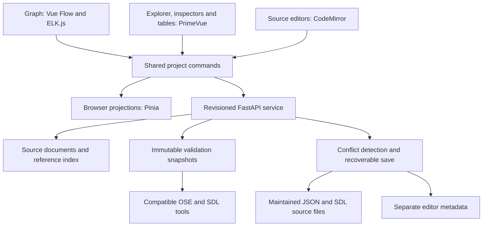

# OSE Model Editor: functional and technical specification

Status: design baseline, version 0.1, 7 November 2026.

This document records the editor concepts and software choices approved for the
`ose-editor` subproject. Implementation and qualification status are recorded in
[the validation record](validation.md). MUST, SHOULD and MAY
denote requirements, recommendations and optional behavior. Requirements apply
to the complete initial authoring release; intermediate milestones MUST identify
their incomplete coverage. All code, interface text, diagnostics and project
documentation are in English.

The accompanying [language coverage inventory](language-coverage.md) is
normative. The [subproject README](../README.md) describes implementation status.

## 1. Purpose and scope

The editor MUST let an application author read, create and modify the complete
OSE application definition accepted by the supported OSE/SDL versions. The
application definition comprises model JSON, deployment JSON and SDL source
units, including schema overrides and references between files.

The principal workload is approximately thirty components. A project can have
multiple deployment documents and many more ports, subscriptions, parameter
blocks and SDL declarations than components. Component count alone MUST NOT be
used as the performance qualification workload.

The product MUST provide three complementary reading and editing approaches:

1. A wiring workspace for components, ports and subscriptions.
2. A model explorer with structured declaration and property editors.
3. A configuration workspace with searchable tables and deployment comparisons.

These approaches share one project state. A synchronized source workspace and
diagnostics/changes panel complete the authoring environment.

The editor MUST work without an OSE broker, coordinator or worker. Saving source
files MUST NOT modify a running application's compiled plan or live parameters.
Navigation to the separate Web Console SHOULD be available when configured.
Source state and runtime observations MUST have distinct provenance if both
are displayed in a future integration.

Application launch, compilation of business handlers, stop, redeployment,
runtime parameter writes and collaborative real-time editing are outside this
initial authoring release. Their absence does not reduce language coverage.
Deployment documents and handler references remain fully editable.

## 2. Selected architecture and software

| Responsibility | Decision |
| --- | --- |
| Subproject, distribution and CLI name | `ose-editor` |
| Python import namespace | `ose_editor` |
| Browser frontend | Vue 3, TypeScript, Vite |
| Interactive graph | Vue Flow with custom component nodes and port handles |
| Automatic layout | ELK.js, initially the ELK Layered algorithm |
| General UI | PrimeVue trees, tables, forms, splitters, menus and dialogs |
| Shared state | Pinia, with an explicit project command/undo layer |
| Source editor | CodeMirror 6; JSON support and a dedicated SDL language extension |
| Server | Python 3.10+, FastAPI and Uvicorn |
| Semantic authority | Matching OSE and SDL validators/compiler/runtime |
| Delivery | Bundled frontend assets, served locally or through configured HTTPS hosting |
| Reference platforms | Linux and Termux for the server; desktop browsers for primary authoring |

Frameworks supply interaction and presentation. The project MUST implement its
own source-preserving document model, reference index, refactorings, diagnostic
mapping and multi-document command history. Pinia does not supply these
semantics automatically; Vue Flow state MUST NOT become the authoritative OSE
model. ELK provides layout calculations, not OSE validation.

Dependencies MUST be pinned in reproducible frontend/backend dependency records
at implementation time. Installed use MUST require neither Node.js nor a CDN.
SDL's optional YAML dependency is required only for projects using YAML sources.
Python web dependencies belong to this subproject, not the OSE engine.

References: [Vue Flow](https://vueflow.dev/guide/),
[ELK.js](https://github.com/kieler/elkjs),
[ELK Layered](https://eclipse.dev/elk/reference/algorithms/org-eclipse-elk-layered.html),
[PrimeVue](https://primevue.dev/treetable/),
[Pinia](https://pinia.vuejs.org/introduction.html),
[CodeMirror](https://codemirror.net/docs/ref/).

## 3. Language authority and compatibility

The initial inventory was reviewed against repository commit
`d4ccf89f0c21182aac27aec2f14aee35202dcc79`. It covers OSE model/deployment
document version 1 and the SDL source language described by the current
[formal syntax](../../sdl/docs/formal_syntax.md) and
[source format reference](../../sdl/docs/schema_formats.md).

OSE's actual loading, structural validation, policy resolution, parameter
validation and plan compilation determine acceptance. Relevant references are
[model loading](../../ose/src/ose/modeling/model.py),
[graph validation](../../ose/src/ose/modeling/validation.py),
[compilation](../../ose/src/ose/modeling/compiler.py),
[delivery policies](../../ose/src/ose/delivery/policies.py),
[parameters](../../ose/src/ose/parameters/model.py) and
[process identities](../../ose/src/ose/execution/identity.py).

The implementation MUST publish its tested OSE/SDL versions or revisions and
expose them through project capabilities. Unknown versions or constructs MUST
remain intact and produce an explicit unsupported-capability diagnostic. The
editor MUST NOT silently remove unfamiliar fields or reinterpret them using an
older grammar. Limited inspection MUST remain possible when safe.

Full coverage means every supported semantic construct has a structured
inspection, creation and modification path. Text fields are appropriate controls
for names, expressions, documentation and arbitrary JSON; an advanced feature
MUST NOT be available exclusively through a raw-source escape hatch. Source
spelling alternatives MUST be preserved and inspectable, and equivalent
spellings such as `message`, `structure` and `struct` MUST be selectable.

Grammar upgrades MUST update the coverage inventory and its qualification
fixtures. Backend-specific naming or generation restrictions MUST identify the
selected target language. A portability recommendation MUST remain distinguishable
from an actual language error.

## 4. Project opening and workspace

A project consists of an application root, an explicitly selected model file,
registered deployment files, reachable schema source units and editor metadata.
The service MUST support opening existing projects and creating a new project
with an incomplete draft. It SHOULD suggest model/deployment candidates without
assuming that all applications use the same filenames.

Opening MUST discover the model's main `schemas` input and all schema overrides
on ports, external topics, shared parameters and `recording_types`. Each source
input MUST retain its own resolution scope: two overrides can describe different
versions of the same logical root without being merged into one global schema.
Declarations resolve across the units belonging to each compiler input set.

The service MUST preserve OSE's path bases: schema paths are relative to the
model file, and deployment paths such as handlers and `cwd` are relative to the
deployment file, with supported substitutions applied by the matching tools.
Absolute paths and sources outside the application root MUST be represented
accurately. Configured additional source roots can grant access to these paths;
unavailable or read-only dependencies receive explicit diagnostics.

The workspace MUST include:

- A header showing the project, selected deployment, dirty state and validation
  status, with Validate, Save and Undo/Redo actions.
- A searchable explorer of components, subscriptions, external topics, schema
  inputs/packages/declarations, shared parameters and deployments.
- A main area switching between Graph, Tables and Sources.
- A property inspector for the selected object, including its source location,
  effective values and usages.
- A diagnostics and changes area linking to both structured controls and source
  ranges, with file diffs and impact previews.

Selection MUST be shared across views and remain stable through renames. View
navigation MUST preserve unfinished edits. Navigation locations SHOULD identify
project-relative documents and object IDs without embedding credentials or full
parameter values in URLs.

## 5. Graph workspace

Component nodes MUST show their name, input/output handles, logical port types
and trigger summary. The graph MUST include external topic publishers and
support fan-out. Required and optional inputs MUST be distinguishable without
color alone. An unconnected required input MUST remain visible as a draft error.

Selecting a component opens ports, trigger, free parameters, parameter bindings,
recording type declarations and selected deployment implementation. Selecting a
port opens its root, source schema, requirement and timeout properties. Selecting
a subscription opens its endpoints, QoS, effective policy, transport, routing
and directional contract compatibility report.

Authors MUST be able to add, duplicate, rename and remove components/ports,
connect or reconnect endpoints, and edit subscription IDs. Connection gestures
MUST give immediate structural feedback. Invalid completed connections SHOULD
be prevented, while existing invalid sources remain editable with diagnostics.
An unresolved compatibility check MUST display a pending or unknown state.

Connections MUST enforce or diagnose the actual OSE rules: a single producer
per input, required-input connectivity, no component cycles, matching logical
roots and publisher-to-consumer SDL compatibility under OSE's required-field
policy. Source/consumer contracts can differ through schema overrides.

The graph MUST provide pan, zoom, fit, minimap, search, multi-selection and
keyboard-accessible alternatives for connection and deletion. A low-zoom view
SHOULD show compact blocks; detailed handles and labels appear at useful zoom
levels or on selection. SDL message fields belong in the inspector/explorer.

Authors MUST be able to highlight upstream/downstream dependencies and paths,
hide or reveal link labels, and save named filtered views. Optional parameter
dependency overlays MUST remain visually distinguishable from subscriptions.

Visual groups MUST be collapsible and MUST NOT create OSE components, execution
boundaries, namespaces or unsupported model keys. Collapsing a group MUST retain
its internal topology and identify crossing connections without losing ports.

Automatic layout MUST be an explicit command using actual node sizes and port
positions. Manual positions MUST survive reopening. Repeated validation or
selection MUST NOT trigger a global rearrangement. Layout SHOULD execute in a
browser worker and preserve pinned nodes through the editor's layout adapter.

## 6. Structured model and configuration editing

All model constructs in the coverage inventory MUST have property controls.
The explorer MUST navigate from a reference to its declaration and from a
declaration to every indexed use in the project.

Separate controls MUST distinguish omitted values from explicitly written
defaults. The inspector MUST display the effective value and its provenance,
such as a default schema input, an explicit schema override or an inferred QoS
setting. Unrelated edits MUST NOT materialize all defaults in source files.

Configuration tables MUST include components, ports, subscriptions, shared
parameters and deployment bindings, with search, sorting, filtering and links
to the graph/source. Multi-object edits MUST have a concrete change preview and
apply as one undoable command. Mixed values MUST remain distinguishable from
empty or omitted values.

Free component `parameters` MUST support the complete JSON value tree rather
than assuming SDL typing. Shared parameter `initial` values MUST use their SDL
root and codec: optional presence, nested messages, enums, complex numbers,
fixed multidimensional arrays and sequences require appropriate typed controls.
Large arrays and sequences MUST be paged or virtualized.

The editor MUST preserve exact integer values, especially int64/uint64 and large
free JSON integers. The browser MUST NOT parse such values through lossy
JavaScript numbers. Arbitrary document numbers require a lossless JSON path;
typed values require a documented exact web representation. Decimal wire
quantum input and constant expressions MUST retain their source text.

## 7. SDL authoring

The schema workspace MUST cover packages, named messages, anonymous nested
messages, enums and items, aliases, constants/expressions, every primitive type,
field IDs, cardinalities, array dimensions, references, documentation and every
`wire(...)` option. Empty messages, forward references, cross-file references
and explicit global references MUST be supported where accepted by SDL.

Field tables MUST show declared and effective IDs, type references and resolved
types, cardinality, declared and resolved dimensions, documentation and wire
properties. Nested structures MUST expand recursively without requiring users
to edit generated anonymous type names.

The constants editor MUST retain arithmetic expressions and show their result,
dependencies and evaluation errors. The aliases editor MUST show alias chains
and final targets. Renaming aliases/constants MUST preserve their uses rather
than replacing all occurrences with resolved primitives or numeric dimensions.

The wire inspector MUST expose `bits`, `q`, `encoding`, `align` and `pad_after`,
including explicit neutral settings. It MUST explain type-dependent combinations
and show applicable ranges and quantization previews through SDL validation.
It MUST NOT infer that `packed` always implies a fixed transmitted byte count
when a custom variable-length encoding is used.

Implicit numbering is meaningful source state. Insertion, removal or reordering
that changes existing effective IDs MUST produce an impact preview. A reviewed
operation can make affected IDs explicit to preserve identity; this change MUST
be visible in the diff and reversible. No refactoring may silently renumber
existing fields or anonymous type identities.

The source/resolved distinction MUST be retained throughout the implementation.
For `alias Sample = fl32; const AXES = 3;`, a field declared as
`Sample[AXES]` MUST retain that declaration while showing the resolved `fl32[3]`.
A runtime catalogue or generated binding is insufficient as an authoring model.

The project MUST support textual SDL and SDL JSON descriptors. Compatible mixed
SDL/YAML/annotated-XSD source sets MUST also remain inspectable and editable
through format adapters as listed in the inventory. XSD support targets SDL's
annotated profile, not general XML Schema editing. Structured XSD modifications
MUST update both schema structure and SDL annotations, including affected
dependency copies. Missing optional format dependencies disable only affected
operations and identify the missing capability.

Format conversion MUST be explicit and previewed. Compiler exports can resolve
expressions, replace field aliases and normalize comments/spelling; they MUST
NOT be used as an invisible save path for maintained sources. Unsupported
cross-format representations MUST produce errors without modifying the input.

## 8. Deployment workspace

Authors MUST be able to register, create, duplicate and compare deployment
documents. One document is selected for effective implementation, transport and
compatibility diagnostics. Other registered documents remain visible and can
be validated independently.

Each component entry MUST support a command argument vector or generated
container, build argument vectors, `cwd`, environment and placement. Container
controls MUST cover Python, C, Rust, Java and Ada, including Java `class` and Ada
`unit` identities and their constraints. Command arrays MUST be edited as
argument arrays; the UI MUST NOT silently turn them into shell scripts.

Deployment editing MUST include execution mode, subscription transport/routing,
frame/datagram limits, broker settings and all external-client limits, process
name prefix/aliases, parameter client identities, access lists and tokens.
Values containing credentials MUST be masked in routine views and excluded
from telemetry/logs; saving MUST preserve their actual source values.

The inspector MUST explain combinations such as distributed TCP-only transport,
direct routing limited to distributed component sources, broker-routed external
inputs, and remote placement limited to distributed deployments. Supported
substitutions MUST remain editable and have a resolved-path preview.

Refactorings MUST account for every registered deployment. Adding/removing a
component MUST make missing or excess deployment entries explicit. A duplicate
component operation MUST expose whether handler paths and parameter blocks
are shared or independently copied.

## 9. Document state, commands and refactoring

The project MUST maintain three distinguishable states: loaded disk baseline,
current authoring draft and resolved/validated snapshot. Each accepted command
increments a project revision. Validation belongs to an exact revision and
selected deployment; stale results MUST NOT describe a newer draft as valid.

Every semantic edit MUST use the same command layer from graph, forms, tables
or sources. Commands MUST carry a base revision, affected objects/documents,
source edits and inverse information. Compound actions, including multi-file
renames, are one undo/redo step. Redo after a divergent edit MUST follow the
documented history policy. Layout operations have editor-only history entries.

Raw-source editing MUST tolerate intermediate syntax errors. Debounced parsing
updates the semantic projection only when consistent; an invalid file MUST show
its current text and diagnostics. Its last valid graph projection, if retained,
MUST be marked stale, with structured edits to affected objects disabled.
Unrelated parseable files SHOULD remain navigable. Cursor editing and semantic
commands MUST share a coherent undo order without feedback loops.

Renaming components, ports, subscriptions, types, packages, aliases, constants
or parameter paths MUST preview indexed reference changes, collisions and
affected files. Schema/package changes MUST show affected ports, parameter
blocks and directional compatibility results. Deletion MUST list dependants.
Moves between source units MUST expose possible catalogue/module changes.

Refactorings MUST use parsed references, not unrestricted text replacement.
Handler source references cannot be proven complete by model analysis: the
preview MUST list affected handlers for review without claiming their business
code was rewritten or verified. External unregistered consumers are outside the
project's reference index and MUST be identified as unassessed.

## 10. Validation and diagnostics

Validation MUST distinguish syntax, document structure, graph constraints, SDL
resolution, directional compatibility, typed initial values, deployment policy
and selected-backend generation constraints. Local checks provide fast feedback;
the matching OSE/SDL tools determine final acceptance.

Explicit Validate MUST operate on an immutable snapshot of the current draft,
including unsaved edits. Snapshot staging MUST preserve source input scopes,
relative-path behavior and configured dependencies. It MUST NOT accidentally
validate a temporary path substitution as if it were an application path.

The authoritative application check MUST reuse the supported `ose validate`
boundary or an explicitly versioned integration provided by OSE. The existing
command generates temporary bindings/wrappers while validating; it does not
compile business handlers or run declared build commands. These temporary
artifacts MUST stay outside maintained sources and ordinary build outputs.
Schema-only checks MUST also be available for incomplete applications.

An adapter can parse compiler diagnostics when no structured public result is
available, retaining the original message. Unstable internal Python classes MUST
NOT be presented as supported public APIs. A richer diagnostic/source interface
added to OSE/SDL must be documented and tested as a separate integration change.

Each diagnostic MUST contain severity, origin/tool, message, revision, deployment
when applicable, and available file/range/object/field locations. Unknown
locations remain project-level; the UI MUST NOT invent a precise range.
Selecting a diagnostic MUST focus its control or source and expand the relevant
tree/page. Checks that were skipped or unavailable MUST never appear passed.

Validation jobs MUST be bounded, cancellable and serialized/coalesced per
project. Superseded results MUST be discarded. Parsing/layout must not block
browser interaction; compiler/generation work must not block the HTTP loop.
The service MUST NOT install dependencies during a request.

## 11. Source fidelity, saving and recovery

Opening and saving an unchanged project MUST preserve every maintained source
file byte-for-byte, including declaration spellings, order, comments, omitted
defaults, newline conventions and numeric literals. Structured edits MUST retain
unaffected source regions. Formatting is a separate, previewed command.

The editor MUST use a source-preserving syntax representation or equivalent
range-based patch mechanism alongside the resolved semantic model. It MUST NOT
reconstruct maintained sources from a normalized SDL catalogue, compiler export
or generated plan. All formats need a documented fidelity strategy.

Save MUST show which source files change and whether the draft is valid for the
selected deployment. Authors MUST be able to save an incomplete or invalid
draft explicitly; doing so preserves errors and does not claim OSE acceptance.
Syntax-invalid source can be saved as an explicit draft. Save MUST NOT require
a complete component implementation or a running application.

Before writing, the service MUST verify expected content hashes for every
affected baseline and dependency relevant to the transaction. External changes
MUST produce a conflict with baseline/draft/current-disk comparison; no automatic
overwrite or merge is implied. Multiple browser tabs also use revision checks.

Multi-file saves MUST use staged writes, per-file atomic replacement where
supported, and a recovery journal/backups sufficient to detect and recover a
partially committed transaction. Filesystem rename does not make a whole
project atomic. Startup MUST detect interrupted saves and offer deterministic
completion or restoration before accepting further writes. Existing file modes
and read-only status MUST be respected.

Editor-only metadata MUST live separately, initially under `.ose-editor/`, with
a versioned `workspace.json` for registered deployments, stable editor IDs,
diagram positions/groups, pinned nodes and named views. Recovery content and
temporary artifacts MUST have separate documented locations and retention.
No editor key may be inserted into OSE model/deployment or SDL descriptors.
Metadata defaults MUST be recoverable if the metadata is missing or corrupt.

Unsaved drafts SHOULD have bounded server-side recovery storage, visibly
distinguished from saved source files. Navigation preserves drafts; closing or
reloading requests a dirty-page warning. Full sources and secrets MUST NOT be
persisted in browser localStorage by default. Reopening recovery content is
explicit and MUST recheck disk baselines.

## 12. Service and frontend boundaries

The browser renders views and sends commands to the project service. The service
owns source baselines, revision checks, parsing/refactoring, staging, validation
and writes. Browser projections are derived from this state. Proposed modules:



| Module | Responsibility |
| --- | --- |
| ProjectService | Root/deployment registration, capability negotiation and revisions |
| DocumentStore | Source bytes, hashes, access status, syntax trees and patches |
| LanguageAdapters | OSE JSON, SDL text and supported SDL descriptor representations |
| ReferenceIndex | Scoped declarations, dependencies, uses and stable object IDs |
| CommandService | Prepared changes, impact previews, apply, undo and redo |
| ValidationService | Snapshot jobs and matching OSE/SDL integrations |
| SaveService | Conflict detection, staged transactions and interrupted-save recovery |
| WorkspaceStore | Layout, groups, preferences and draft recovery metadata |
| GraphAdapter | Domain-to-Vue-Flow projection and ELK layout integration |
| SourceAdapter | CodeMirror documents, source locations and diagnostics |

The initial service owns one writable project per process with one Uvicorn
worker. A project lock MUST prevent another editor process from becoming a
concurrent writer. External terminal/IDE edits remain possible and are detected
through file hashes. Real-time multi-user collaboration is not implied.

The planned source layout is:

```text
ose-editor/
  src/ose_editor/       Project service, adapters, commands and persistence
  frontend/src/         Vue workspaces, graph, inspectors and source editors
  tests/                Service, fidelity, integration and acceptance tests
  examples/             Authoring examples and representative workload fixtures
  docs/                 Specification, coverage, API and qualification records
  pyproject.toml        Independent Python distribution
```

The implementation follows this layout. Qualification workload helpers currently
live in `tests/`; application examples remain in their existing subprojects.

## 13. API contract principles

HTTP routes MUST be versioned under `/api/v1`. This table defines required
operations; detailed request schemas belong to the implementation API reference.

| Operation | Required result |
| --- | --- |
| Read project/capabilities | Current revision, source inputs, deployments, tools and writable capabilities |
| Read documents/projections | Exact source representation and matching structured object/source mappings |
| Prepare command | Base revision, semantic impact, affected files and source diff |
| Apply command / undo / redo | Revision-checked mutation and updated projections |
| Start/read/cancel validation | Job ID, snapshot revision, deployment, status and diagnostics |
| Read usages/compatibility | Scoped references and directional contract report |
| Save / inspect recovery | Expected baselines, transaction state and explicit conflicts |
| Read/write workspace metadata | Editor-only versioned layout and view data |

Revision IDs and content hashes MUST be opaque strings. API schemas MUST
represent exact numeric literals without precision loss and distinguish absent
properties from explicit null/default values. Mutations with stale revisions
MUST return a conflict response, initially HTTP 409, without partial application.
Asynchronous validation events MAY use WebSocket or polling; replies MUST carry
their snapshot revision either way.

## 14. Local operation and access

The default server MUST bind to loopback and limit file access to configured
project/source roots. Access checks MUST use canonical resolved paths, including
symlinks, while preserving authored path spelling. The browser MUST NOT gain
arbitrary filesystem access through path arguments.

Authentication, origin validation and mutation protection MUST cover local web
access; non-loopback hosting requires configured authenticated HTTPS. Application
deployment tokens and source contents MUST NOT be placed in URLs or routine
logs. Documentation/comments MUST render as text or sanitized content.

Opening, saving and validating a project MUST NOT run its deployment `command`,
`build` entries or business handlers. Validation may invoke only configured
trusted OSE/SDL tooling in isolated jobs. The project trust boundary and any
future action that executes application code MUST be explicit.

## 15. Performance and usability qualification

The initial reference fixture MUST contain at least thirty components, 240 total
input/output ports, 120 acyclic subscriptions including fan-out, five visual
groups, three deployments, fifty shared parameter blocks, and 2,000 total SDL
fields across packages and schema overrides. Initial values MUST include a
large paged sequence and fixed multidimensional arrays. Counts describe the
combined fixture; they are not language limits.

Acceptance targets below apply to a warm local session on a documented reference
desktop, served over loopback. The qualification record MUST name CPU, RAM, OS,
browser, viewport, dependency versions and fixture revision. Targets are
requirements to measure, not existing performance claims.

| Interaction | Initial target |
| --- | --- |
| Select a component and render its basic inspector | p95 at most 150 ms |
| Pan/zoom/drag in the reference graph | At least 30 frames/s during a documented interaction trace |
| Apply an ordinary property edit to affected views | p95 at most 250 ms, excluding authoritative validation |
| Open the reference project to an interactive graph | At most 3 s, excluding cold authoritative validation |
| Automatic layout of the reference graph | At most 2 s without blocking input |
| Ordinary edits and layout repetition | No monotonic memory growth after repeated cycles and cleanup |

Tool validation duration MUST be reported separately, with progress/cancellation;
it MUST NOT freeze editing. Large value trees and tables MUST render bounded
visible content. No full-project codec round-trip or global layout may run on
every pointer move or keystroke.

Keyboard navigation, visible focus, accessible labels and non-color state
indicators are required. Desktop Chromium and Firefox MUST be qualified. Touch
navigation and Linux/Termux server operation MUST have a documented smoke test;
desktop performance targets MUST NOT be presented as mobile guarantees.

## 16. Required acceptance evidence

| ID | Acceptance criterion |
| --- | --- |
| A01 | Open Vibration Watch, navigate every component/port/subscription and inspect its SDL contracts and deployments without a running OSE application. |
| A02 | Create and modify every inventory construct through structured controls; no semantic construct is source-only. |
| A03 | Open/save unchanged SDL and descriptor fixtures byte-for-byte, including comments, omitted defaults, aliases, expressions and declaration spellings. |
| A04 | Make a structured edit and preserve unrelated source regions; show equivalent graph, form, table and source state. |
| A05 | Rename a component/port/subscription and update all indexed model/deployment references as one reversible command. |
| A06 | Edit an alias, package, constant, anonymous structure and wire clause; retain declaration intent and report affected uses. |
| A07 | Insert/reorder implicit-ID fields and expose all identity changes or explicit-ID stabilization before applying. |
| A08 | Diagnose cycles, competing producers, missing required connections and incompatible publisher-to-consumer contracts. |
| A09 | Explain QoS defaults and invalid transport/routing/retry combinations using matching OSE validation. |
| A10 | Validate unsaved snapshots, retain source inputs/path bases, discard stale results and never run application build/handler code. |
| A11 | Edit shared initial values containing uint64 maxima, optionals, complex numbers, arrays and sequences without precision loss. |
| A12 | Edit every deployment field, compare profiles and identify incomplete component coverage across registered deployments. |
| A13 | Keep a syntax-invalid draft/source visible, mark stale projections, save it explicitly and recover structured editing after repair. |
| A14 | Detect terminal/IDE edits and stale browser revisions; preserve both draft and current disk contents on conflict. |
| A15 | Inject an interrupted multi-file save and demonstrate deterministic recovery without silent source loss. |
| A16 | Persist grouping/layout separately; deleting editor metadata leaves an ordinary OSE application. |
| A17 | Preserve supported mixed-format SDL projects; preview explicit conversion and reject unrepresentable conversion without modifying inputs. |
| A18 | Reuse OSE/SDL accepted/rejected fixtures, report target-language restrictions and fail unsupported-capability checks explicitly. |
| A19 | Meet the measured thirty-component workload targets and publish the qualification record. |
| A20 | Complete the authoring journey below and validate the saved result through the independent OSE CLI. |
| A21 | Build the standard framework bundle with the editor backend, compiled frontend, complete offline dependencies and licenses; install and launch `ose-editor` outside the checkout without system Python, Node.js, a CDN or network access. |
| A22 | Verify editor feature/profile selection, upgrade/deselection, command conflicts, relocation and shell-fallback behavior; open, edit, save and independently validate an external application using only installed resources. |

The principal end-to-end journey is: open a copy of Vibration Watch, understand
its graph, modify a port/contract, adjust a subscription, inspect impacts, change
a deployment setting, validate the unsaved snapshot, save, reopen and validate
the saved files with OSE. It MUST include undo/redo and a conflict case.

Test layers MUST include source/command unit tests, language-adapter conformance
and fidelity fixtures, OSE/SDL integration checks, browser workflows and measured
performance qualification. Fixtures for accepted constructs need relevant
rejection cases and boundary values; duplicating UI implementation details is
not sufficient evidence.

## 17. Framework release bundle

The editor MUST be included in the existing self-extracting framework release
produced by `make release`. A standalone editor package does not satisfy this
requirement. Integration with the framework installer and installed smoke checks
is a prerequisite for the complete initial authoring release.

The standard bundle MUST carry the editor's Python backend, compiled Vue assets,
required Python wheels and native dependencies, licenses and compatible OSE/SDL
authoring resources. Runtime assets MUST include Vue Flow, ELK.js, PrimeVue,
Pinia and CodeMirror; installed use MUST NOT fetch JavaScript or WebAssembly
from a CDN. Frontend build tools and development dependencies stay outside the
installed payload. The release builder MUST reject a missing or incomplete
editor frontend once editor inclusion is enabled.

The planned installed resource directory is `framework/ose-editor/`, with an
`ose-editor` launcher in the configured command directory. The launcher MUST use
the bundle's private Python and installed framework paths, preserve the caller's
working directory and work without a source checkout or `setenv.sh`. The
manifest MUST cover editor assets, dependencies and hashes; the installation
report MUST record editor selection and actual capability/import checks.

The installer MUST provide an `editor` feature independent of the console's
`web` feature. The default SDK installation with `--features all` MUST include
the editor. Complete authoring/validation requires the SDK profile and its
generator/SDK resources. A runtime-only profile MUST omit the editor from its
profile-adjusted `all` selection with a clear diagnostic; explicitly requesting
`editor` with the runtime profile MUST fail selection with instructions to use
the SDK profile. Language selections MUST distinguish editable deployment
languages from the installed resources available for backend validation.

Dependency collection MUST include the editor's locked requirements and resolve
shared web dependencies consistently with `ose-ws`. All advertised source-format
capabilities, including YAML, MUST be usable offline in the default SDK bundle.
Selection changes and upgrades MUST refresh/remove owned editor resources and
launchers while preserving external application files and authoring state.
The shell recovery installer MUST carry editor resources and install a deferred
launcher consistently with existing fallback behavior.

The implementation MUST update these existing release integration points:

| Integration point | Required change |
| --- | --- |
| `tools/release/build.py` | Editor resources/assets, locked dependency collection, license notices and manifest coverage |
| `tools/release/install.py` | Feature/profile selection, installed resources, dependency/capability checks and owned launcher management |
| `tools/release/launch.py` | Editor dispatch and installed Python/framework path setup |
| `tools/release/install-resources.sh` | Resource-only recovery and deferred editor launcher |
| `tools/release/tests/` | Bundle contents, selection, upgrade/removal, integrity and fallback coverage |
| `tools/release/check.py` | Installed editor authoring journey on an external application |
| `Makefile` and `.github/workflows/release.yml` | Frontend/release dependencies and editor change triggers/qualification |
| `docs/release.md` | Installed layout, feature/profile options and editor usage |

Release qualification MUST run outside the checkout with an unreachable package
index and no usable system Python or Node.js. It MUST exercise editor startup,
bundled assets, opening an external application, structured editing, saving and
OSE validation through installed resources. Qualification fixtures remain test
inputs, not bundled user applications. Full authoring must work without an OSE
application running. The bundle MUST NOT include application models, credentials
or existing user/editor state.

These are release requirements. Packaging/installer integration is implemented;
the validation record distinguishes exercised integration from outstanding full
language and desktop UI qualification. See the framework's
[release guide](../../docs/release.md).

## 18. Delivery sequence

1. Establish source-preserving adapters, capability inventory and the document/
   command model, with no-op fidelity and exact-value fixtures.
2. Implement project opening, explorer, inspectors and source synchronization,
   including invalid drafts and revisioned validation.
3. Add graph authoring, ELK layout, visual grouping, tables and deployment
   comparison using the shared command layer.
4. Complete advanced SDL/descriptor controls, impact analysis and multi-file
   refactorings, save conflict detection and recovery.
5. Qualify the complete inventory and representative workload, document the API,
   package the independent application and integrate/qualify it in the standard
   offline framework release bundle.

Milestones can be delivered for review before all features are complete. The
complete initial release MUST satisfy every inventory row and acceptance
criterion. A partial prototype MUST NOT be described as covering the full OSE
and SDL languages.

The installed entry point is `ose-editor`, with project root, model, deployment
selection and SDL tool path options documented in [the README](../README.md).
The [API reference](api.md) describes the implemented revisioned service.
