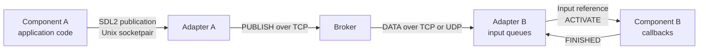

# Runtime execution and message flow

This page describes the default `realtime` engine with application model v2.
The [simulator](simulation.md) runs the same callbacks with virtual time and
deterministic publication barriers.

A Push receipt, inactivity timeout or timer expiration activates one input
callback. Other inputs do not gate it. Pull inputs are passive inboxes read
explicitly during another activation. Each component processes one callback at
a time; distinct components progress independently.

## Runtime actors

Three actors participate in a message exchange:

| Actor | Responsibility |
| --- | --- |
| Component | Executes application code: acquisition, calculation, filtering, display, and so on. |
| Component adapter | Handles network reception, input queues, acknowledgements, scheduling and local communication with the component. |
| Broker | Routes publications to subscriptions and manages an independent delivery queue and policy for each subscription. |

The current implementation runs each component and its Python adapter as two
separate processes. The supervisor hosts the broker and launches the adapters.
The component process can use Python, C, Rust, Java or Ada.

The local adapter/component exchange uses the binary [CH/2 protocol](../sdk/input-protocol.md) over
a private Unix socketpair. Standard input, output and error belong to the component. Broker exchanges use [CENV/2](cenv2.md), with an S2PS/2 envelope containing
the catalogue identity and SDL2 message bytes. The adapter adds or removes that
envelope at the network boundary.

TCP reception extracts complete CENV/2 frames directly from the stream receive
buffer, including consecutive frames received together. The frame length is
checked before waiting for its body. Metadata is decoded within that frame's
bounds and the returned payload is immutable bytes, independent of later buffer
compaction. Large payloads require one payload copy during extraction; the
complete packet is not copied first. Small payloads use short byte copies to
avoid buffer-view overhead.

The framed reader isolates access to asyncio StreamReader's buffer and wait
methods. Standard StreamReaderProtocol/StreamWriter retain read flow control,
write backpressure, connection cleanup and TLS. A caller supplying an ordinary
StreamReader to TCP retains the readexactly path.

## Startup

1. The supervisor starts the broker and one adapter per component.
2. Each adapter connects its subscriptions and starts its component process.
3. INIT supplies configuration and port catalogues, followed by initial readable
   shared parameter blocks.
4. The generated container initializes codecs, checks callback signatures and
   invokes the optional start hook, then sends CH/2 READY byte 0x02.
5. Once every modeled component is ready, the supervisor enables execution.

Empty inputs do not prevent initialization. Automatic timer delays and Push
inactivity waits begin at execution activation. Manual timers wait for explicit
arming. External clients do not participate in this startup barrier.

## Publication and network admission

During a callback, a generated publication method encodes a typed value with
the declared output catalogue and sends PUBLISH to the adapter. The SDK and
engine enforce the activating event's output permissions. An optional uint64
application ID remains separate from the engine publication handle.

The adapter collects outputs until successful FINISHED. It validates each
payload, commits input withdrawals and then sends staged publications to the
broker. A failing callback exposes none of those outputs.

For each publication:

1. The adapter wraps the SDL bytes in S2PS/2 and sends a CENV/2 TCP request.
2. The broker validates the message and attempts admission independently for
   each matching subscription, reporting each result.
3. Subscription send loops transmit DATA over TCP or UDP. TCP uses separate
   data connections so a blocked receiver does not block control replies.
4. The destination adapter checks the topic, catalogue identity, dynamic SDL
   compatibility and payload validity before input admission.

The broker's subscription queue and destination input buffer are separate.
A bounded staging queue separates network reception from input admission;
each subscription has its own admission worker. Multiple producers feeding
one input share its reception policy and capacity. See
[shared input reception](delivery.md#shared-input-reception).

Catalogue discovery remains dynamic per message. CENV/2 does not freeze a route
to one contract or change SDL compatibility and collision handling.

## Selecting one activation

The parent scheduler chooses one Push origin per component: a queued FIFO
record, a new latest record, an inactivity expiration or a timer expiration.
It passes a reference containing the input, event, logical time, due time,
elapsed deadline count and optional message metadata. A timeout has no message.

Push FIFO origin records are protected while their callback is active, then
consumed on success. A latest origin is processed once per publication identity;
retaining that value does not repeatedly activate its Push callback.

There is no combined multi-input snapshot or `on_tick`. A component needing a
join keeps explicit application state, for example correlating branch messages
by sequence. For periodic sampling, declare an independent timer and a Pull
input with a latest reception policy.

Only outputs listed under the origin's `activates.message` or
`activates.timeout` may be generated by that event. An input with no output
links may still compute and update state. Validation checks the activation graph,
allowing passive feedback while rejecting a cycle of activating messages.

## Pull access

During an active callback, `get` reads without reservation or consumption,
`pull` reads and consumes, and `remove` consumes without returning a message.
These operations never wait for future data. Selectors may specify application
ID, exact engine handle and source topic; repeated application IDs select the
oldest matching message.

Eligible handles are frozen at callback selection. Messages received while it
runs become accessible at the next activation. Existing Pull records remain
subject to overflow eviction; reading does not protect their queue slots.

Pull/remove hide their selected handles immediately within the callback and
journal withdrawals. FINISHED commits them and releases capacity before outbound
admission waits. Failure cancels the journal. Independent overflow evictions
are not rolled back. Saved inbox references expire with the callback.

## Inactivity timeouts and timers

A Push message input may declare a finite positive `timeout` in seconds.
It measures inactivity since new message reception, including callback execution
time. New valid receptions reset the deadline even if a full buffer refuses them.
Recognized retries do not reset inactivity within the receipt window.

The same input callback receives `event="timeout"`, no message and an elapsed
deadline count. A new receipt cancels pending timeout activations that have not
started; it never interrupts a running callback. Expirations repeat while
inactivity continues. A retained latest value does not suppress the timeout.

Pull inputs have no activating timeout. Explicit timer inputs have no SDL
message contract and support periodic or one-shot modes, a positive delay and
automatic or manual start. They invoke their own input callback. The first
expiration follows the delay; there is no implicit zero-time source activation.
Periodic cadence is preserved and missed deadlines coalesce. Arming starts the
delay; disarming cancels future expirations.

Timeouts are local events, independent of ACK deadlines and admission waits.
They create no network messages, acknowledgements or retries. See
[model declarations](model-v2-migration.md#timers-and-output-permissions).

## Completing a callback

~~~text
Engine -> component: ACTIVATE one input reference
    Application callback computes, reads Pull inboxes and stages outputs.
Component -> engine: PUBLISH result
Component -> engine: FINISHED
    Engine commits withdrawals, then attempts outbound publication admissions.
~~~

Callbacks are synchronous. Python normal return, Rust Ok, C nonzero success
without a marked SDK error, Java normal void return and Ada normal procedure
completion send FINISHED. An exception, crash or missing FINISHED cancels
withdrawals and staged outputs. There is no additional business result in
FINISHED.

Logs, measurements, recording, parameter writes and timer controls have their
own service semantics and are outside the withdrawal journal. Their effects
are not rolled back with a failed callback. See [callback containers](callbacks.md).

## Admission, acknowledgement and processing completion

These confirmations describe different stages:

| Event | Meaning |
| --- | --- |
| Publication result `accepted` | The broker admitted the publication into RAM for that subscription. |
| ACK `received` | The destination adapter validated the message and admitted it into its input buffer in RAM. |
| FINISHED | The component completed the application processing for its callback. |

An ACK can reach the broker before the application callback starts. It does not
confirm completion of that callback or survival of a crash. Conversely, a
publication result does not wait for all downstream components to finish.

For an acknowledged subscription, the broker retains a pending sender record
until an ACK arrives or its configured attempt budget is exhausted. If the ACK
does not arrive by the deadline, the retry policy allows a bounded number of
retransmissions. The receiving adapter recognizes duplicates using its bounded
RAM history and does not admit them again within that window. A recognized
duplicate can be ACKed again if the previous ACK was lost.

Without acknowledgement, the broker removes the sender record after sending it.
An admitted message can subsequently be replaced by an overflow policy or lost
when its process stops. All queues, retained states, retry state and deduplication
history are volatile.

## Concurrent components and output visibility

After startup, real-time execution has no global callback barrier. Outputs become
eligible for delivery after their callback succeeds. Downstream components can
then process them while the emitter waits for later output admissions or starts
future work. Successful callbacks do not form a transaction across the graph.

Admission refusals are reported; they do not retry the application callback or
undo committed withdrawals. All queues, retained states and deduplication
histories are volatile. The [simulator](simulation.md) additionally holds outputs
behind a deterministic wave barrier.

## Backpressure and ordering

When a consumer cannot keep up, its bounded queues apply their configured policy:

| Policy | Behavior |
| --- | --- |
| `reject_new` | Refuse a new message when the queue is full. |
| `drop_oldest` | Evict the oldest record that is not reserved by a running Push callback. Refuse if no such record is available. |
| `wait` | Wait for space up to a configured deadline, then refuse if the queue is still full. UDP does not support this policy. |
| `latest` | Keep the most recent admitted state for subsequent selection. A running callback retains its origin value. |

Broker admission waits can delay further output delivery and the emitter's next callback.
Each subscription's admission and send loops remain independent, although an
emitter's publication reply includes the outcomes of all matching subscriptions.

FIFO preserves admission order within a queue. UDP loss and retransmission can
make that order differ from publication order. The current implementation does
not reorder messages by sequence number before FIFO admission. Retries provide
bounded additional delivery attempts, not a guarantee of processing in original
publication order.

## The acquisition example

| Component | Inputs and runtime behavior |
| --- | --- |
| `acquisition` | A 20 ms timer creates each measurement. |
| `analyse` | A Push FIFO callback transforms one measurement. |
| `observation` | A Push FIFO callback observes each retained result. |
| `affichage` | A 100 ms timer reads a Pull/latest input and may skip intermediate values. |

The [model](../examples/acquisition/model.json) sends acquisition-to-analysis
over TCP. Result subscriptions use UDP with ACK/retry for observation and latest
without ACK for display. These policies do not change callback activation rules.

## External clients and implementation

[External client SDKs](clients.md) invoke callbacks serially per subscription,
with independent workers across subscriptions. They do not exchange CH/2 frames.
Publishing into a declared topic still feeds the modeled input's normal queue.

- [Activation scheduler](../src/ose/execution/activation.py): origin selection,
  inactivity, timer cadence and withdrawal commit.
- [Adapter](../src/ose/execution/adapter.py): network admission, CH/2 and output staging.
- [Input services](../src/ose/execution/input_ipc.py): nonblocking inbox/timer requests.
- [Broker](../src/ose/execution/broker.py): routing and independent subscription queues.
- [CH/2](../sdk/input-protocol.md): activation references, publication IDs and requests.
