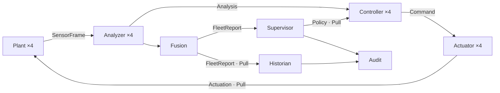

# Thermal Workshop — OSE Web Console load application

Twenty Python components model four independently heated cells, with four local
feedback loops and four supervisory feedback paths. This is a synthetic workload
for **ose-ws**, not a physical plant model or a performance benchmark result.
It uses the actual SDL generated codecs, OSE processes, queues and parameter RPCs.

## Graph

Each cell contains `plant_N`, `analyzer_N`, `controller_N`, `actuator_N`:



There are **20 components, 28 subscriptions, 5 editable parameter blocks and
83 scalar measurements**. The four control loops regulate temperature using
feedforward plus proportional correction. Actuators limit power slew. The
supervisor adjusts cell targets to reduce thermal imbalance. Fusion reports the
latest analysis from each cell; it is an asynchronous aggregation, not a strict
join of matching timestamps. Historian keeps a bounded recent history.

Plant and historian timers drive the graph. Feedback uses bounded `latest` Pull
inboxes, consumed by the next activation, so cycles do not spin indefinitely at
one simulated instant. Forward paths use bounded FIFOs with `drop_oldest`; fusion
uses `latest` buffers. Under overload, losses/replacements are expected and visible
in the console. Runtime keeps its regular component diagnostics and real-time
queue policies.

## Start with the web console

From the repository root, in a Bash terminal:

```sh
cd thermal-workshop
source ./setenv.sh
ose app run LOAD=nominal
```

The run is unlimited until Ctrl+C. In a second Bash terminal:

```sh
cd thermal-workshop
source ./setenv.sh
ose-ws
```

Open **http://127.0.0.1:8080** for direct local access. Use `ose-ws --auth`
to require the browser token in `thermal-workshop/.ose-ws/access.token`.
The application environment selects this
application's plan, parameter client and endpoint; it does not reuse Vibration
Watch's state. First launch prepares missing console services if needed.
This example's local operator credential in `deployment.json` is for loopback
development, as in Vibration Watch. Use the console's normal proxy/authentication
configuration for remote access.

Useful pages and exercises:

- **Components**: inspect 20 nodes, 28 links, metrics, link health and history.
- **Live** on a plant → analyzer link: expand nested channels and watch changing
  sample counts, optional diagnostics, notes and tags. Real-time execution is
  required for Live previews and dynamic captures.
- **Measurements**: select temperatures, powers, targets, samples and message
  counts from several cells; compare combined and separate charts.
- **Parameters**: edit `cells/N/settings` targets/gains and the shared `workload`
  block. All cells see the shared workload. Change `max_samples`, `burst`,
  `cpu_iterations` or `log_every` during a run, and observe the resulting load.
- **Recordings**: capture plant frames and fleet reports; inspect the resulting
  variable payloads offline with `ose app record inspect FILE --summary`.
- **Logs**: lifecycle events and sampled workload logs; reduce `log_every` to
  increase log volume without enabling per-message terminal printing.

## Load profiles

```sh
ose app run LOAD=busy
ose app run LOAD=stress --duration 30
# Finite standalone run, without the shell environment:
make run LOAD=nominal DURATION=30
```

| Profile | Plant period | Frames per plant tick | First-channel samples | Analyzer CPU iterations |
| --- | ---: | ---: | ---: | ---: |
| nominal | 100 ms | 1 | 64–256 | 0 |
| busy | 20 ms | 2 | 256–2,048 | 1,000 |
| stress | 10 ms | 4 | 1,024–8,192 | 5,000 |

Each plant frame has 1–4 channels; subsequent channels have fewer samples. The
profile also changes fusion's period (twice the plant period) and historian's
period (five times the plant period). Profiles are selected at build/start;
parameter edits affect payload size, burst, CPU work, logs and regulation live,
but not timer periods. Rebuilding/reset restores initial profile values.

These are **offered workloads**, not promised throughput. `stress` can saturate
this Termux device; start with `nominal`, then `busy`. CPU work, burst, channel
samples and retained history are bounded in the handlers even when parameters
are edited. Per-frame limits: 1–4 channels, at most 8,192 samples in the first
channel, at most 16 frames per plant activation, 200,000 CPU iterations per
analysis. History retains 64 means. Logs and web histories use the framework's
normal bounded stores. Bounds on values do not make arbitrary strings or every
possible parameter document a fixed-size workload.

## Simulation

```sh
source ./setenv.sh
ose app simulate --duration 60 --interactive LOAD=nominal
# Second terminal: source ./setenv.sh; ose-ws
```

The server starts paused. The Simulation page supports stepping, pause/resume,
reset and persistent time breakpoints. CLI controls share the same command
service. Virtual time labels measurements and rates; component resources and
connection freshness use real time. A fast simulated run can skip intermediate
observations in ose-ws. Use **real time** for sustained console/Live/capture load;
use simulation for repeatable functional scenarios and control testing.

```sh
make simulate LOAD=nominal DURATION=3 WORKERS=4
```

All signals and message shapes are deterministic functions of logical time,
cell and sequence; no random or wall-clock inputs are used in the handlers.
Real-time scheduling may drop messages according to the configured policies.

## Message structures

The SDL contract is [schemas/messages.sdl](schemas/messages.sdl). Six root types
are exchanged, with nested structs rather than JSON strings inside messages:

| Root | Variable structure |
| --- | --- |
| `SensorFrame` | 1–4 channels, packed float samples, repeated tags, optional note and diagnostic with repeated hints |
| `Analysis` | repeated features, optional units, optional spectrum with variable bins, optional diagnostic |
| `Command` | repeated reasons, optional ramp with a varying stage count |
| `Actuation` | variable stages, optional stage notes, optional protection diagnostic |
| `FleetReport` | repeated analyses and alarms with nested evidence, variable bounded history, optional note |
| `Policy` | repeated cell targets, optional per-cell reason and optional global note |

Optional fields alternate between present and absent, array lengths vary across
frames, and timestamps/sequences use uint64. The web console's exact integer
representation and expandable message tree can therefore be exercised together.

## Build and tests

```sh
make validate
make build LOAD=busy
make test
```

`model.json` and `deployment.json` are editable source files. The preparation
script selects a load profile and resolves paths into ignored `build/prepared/`;
generated containers and SDL Python types are in `build/components/`.
Tests build the actual application in an isolated temporary directory, exercise
all 20 subprocesses and feedback, round-trip changing nested messages through
SDL, and verify ose-ws graph, parameter, log and measurement APIs. A real-time
test also checks Live message previews and concurrent API reads. Tests stop
their component processes and leave the application's selected build untouched.
The web integration tests require the
optional ose-ws dependencies (`source ./setenv.sh; ose-ws setup`).
